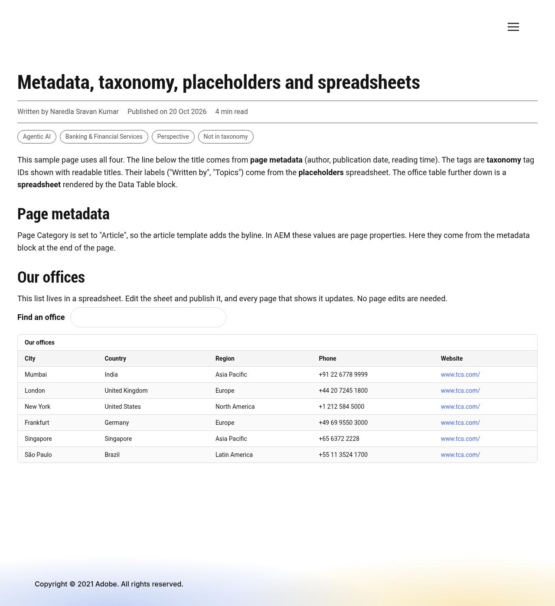

# Metadata, Taxonomy, Placeholders and Spreadsheets

How four Edge Delivery Services concepts work on this site (AEM authoring with Universal Editor), when to use each, and the sample that shows all four together.

| Concept | In one sentence | Typical use |
|---|---|---|
| **Metadata** | Information *about* a page (title, description, author, category, …) | SEO, social sharing, bylines, choosing a page template |
| **Taxonomy** | A shared set of tags that classify pages | Topic chips, filtering, related content |
| **Placeholders** | Site-wide short texts kept outside the code | Button and label wording, translations |
| **Spreadsheets** | Tabular data published as JSON | Office lists, product specs, redirects, any list shown on several pages |

**Sample:** `drafts/concepts` (local preview: `npx aem up --html-folder drafts --prefer-plain-html --port 3001`, then open `/drafts/concepts`).



---

## 1. Metadata

**What it is.** Each page has page properties. Edge Delivery writes them into the page head as `<meta>` tags, and code reads them with `getMetadata('name')`.

| Kind | Where authors set it | Example on this site |
|---|---|---|
| Page metadata | Page **Properties** in AEM / Universal Editor (model `page-metadata` in `models/_page.json`) | Title, Description, Author, Publication Date, Reading Time, Page Category, Tags, Navigation, Footer |
| Bulk metadata | A **Metadata** spreadsheet page (mapped to `/metadata.json` in `paths.json`) | Same values for many pages at once, by URL pattern |

AEM also adds `cq-tags` (the page tags), `modified-time` and `published-time` automatically.

**Use cases on this site:**
- **Page template:** Page Category "Article" loads the article template (`templates/article/`), which adds the byline and tag chips.
- **Byline:** Author, Publication Date and Reading Time appear under the title.
- **Header and footer:** the **Navigation** and **Footer** fields pick the nav and footer pages.
- **Bulk metadata:** e.g. give every page under `/insights/` the category "article", or a default social image, without opening each page.

**In code:**
```js
import { getMetadata } from '../../scripts/aem.js';
const author = getMetadata('author');
```

---

## 2. Taxonomy

**What it is.** Tags are managed in AEM's **Tagging** console, e.g. `eds-demo:topic/agentic-ai`. A page only stores tag **IDs** (in `cq-tags`). A **Taxonomy** page publishes each tag's **title** (and optionally other properties) as a spreadsheet, so the site can show "Agentic AI" instead of the ID.

**Use cases:**
- **Topic chips on articles** (built here): the article template turns the page's tag IDs into titled chips.
- **Filtering:** list only the cards or pages tagged "Banking".
- **Related content:** show other pages that share a tag.
- **Translations:** the taxonomy can return titles per language (`?sheet=de`).

**Authoring steps in AEM:**
1. **Tools → Tagging:** create tags, e.g. namespace `eds-demo` with `topic/agentic-ai`, `industry/banking`.
2. **Sites → EDS Demo → Create → Page → Taxonomy** template. Name it `taxonomy` and select the namespaces to include.
3. Publish the taxonomy page. It's mapped to `/taxonomy.json` in `paths.json` (added in this change).
4. On a page, open **Properties → Tags** and pick tags (new **Tags** field in the Universal Editor page properties).

**Published format:**
```json
{ "data": [ { "tag": "eds-demo:topic/agentic-ai", "title": "Agentic AI" } ], "columns": ["tag", "title"], ":type": "sheet" }
```

**In code** (`scripts/taxonomy.js`):
```js
import { getPageTags, fetchTaxonomy, tagTitle } from '../../scripts/taxonomy.js';
const taxonomy = await fetchTaxonomy();
const titles = getPageTags().map((tag) => tagTitle(tag, taxonomy));
```
A tag that's missing from the taxonomy still gets a readable title from its ID, e.g. `…/not-in-taxonomy` → "Not in taxonomy".

---

## 3. Placeholders

**What it is.** A spreadsheet with the columns **Key** and **Text**. Code asks for a key and gets the text, so wording changes don't need a developer, and a translated site only needs a translated sheet. Keys are camel-cased: "send question" → `sendQuestion`.

**Use cases on this site:**

| Key | Default text | Used by |
|---|---|---|
| `by` | By | Article byline |
| `published` | Published | Article byline |
| `tags` | Tags | Article tag list (screen-reader label) |
| `send question` | Send question | Ask block send button |
| `ask by voice` | Ask by voice | Ask block microphone button |
| `data table search` | Search | Data Table search box |
| `data table showing` | Showing {0} of {1} | Data Table result count (`{0}` shown, `{1}` total) |
| `data table no results` | No matching rows | Data Table, no matches |
| `data table empty` | No data to show. | Data Table, empty sheet |

Every key has a built-in default, so nothing breaks before the sheet exists. The sample sheet changes "By" to "Written by" and "Tags" to "Topics", so you can see it working.

**Authoring steps in AEM:**
1. **Sites → EDS Demo → Create → Page → Placeholders** (or Spreadsheet) template. Name it `placeholders`, with the columns **Key** and **Text**.
2. Add rows, e.g. Key `by`, Text `Written by`.
3. Publish. It's mapped to `/placeholders.json` in `paths.json` (added in this change).
4. **Other languages:** create `/fr/placeholders` and set the page metadata **placeholders** to `/fr/placeholders` for French pages (for example through bulk metadata).

**In code** (`scripts/placeholders.js`):
```js
import { fetchPlaceholders, placeholder } from '../../scripts/placeholders.js';
const placeholders = await fetchPlaceholders();
button.setAttribute('aria-label', placeholder(placeholders, 'sendQuestion', 'Send question'));
```
Placeholders load after the page is visible, and the defaults show until then. They never slow down the first paint.

---

## 4. Spreadsheets

**What it is.** Any table authored in AEM as a **Spreadsheet** page and published as JSON. Placeholders, taxonomy, metadata and redirects are all spreadsheets with agreed columns; you can also create your own with any columns.

**Use case built here: the Data Table block.** It shows any spreadsheet as an accessible table, here an office directory. Edit the sheet, publish it, and every page that shows it updates.

| Field | Notes |
|---|---|
| Spreadsheet | The spreadsheet page, e.g. `/data/offices`. It must be mapped in `paths.json` |
| Caption | Names the table for all readers, e.g. "Our offices" |
| Show Search Box | Adds a search box that filters the rows |

Behaviour:
- Columns appear in sheet order.
- Columns starting with `_` (e.g. `_owner`) are internal and not shown.
- Values that are URLs or site paths become links.
- Wide tables scroll sideways inside a keyboard-focusable area.

**Other spreadsheet use cases:** product specifications, event schedules, price lists, store opening hours, redirects (`/redirects.json`), configuration values.

**Authoring steps in AEM:**
1. **Sites → EDS Demo → Create → Folder** `data`, then inside it **Create → Page → Spreadsheet** named `offices`, with the columns City, Country, Region, Phone, Website.
2. Fill the rows, or **Upload** a CSV.
3. Publish. `/content/eds-demo/data/offices` is mapped to `/data/offices.json` in `paths.json` (added in this change). For a new sheet, add a similar line to `paths.json` (a developer change).
4. On any page, add **Data Table**, choose the spreadsheet, set a caption, and optionally turn on the search box.

**Published format:**
```json
{ "data": [ { "City": "Mumbai", "Country": "India", … } ], "columns": ["City", "Country", …], ":type": "sheet" }
```

**In code** (`scripts/sheets.js`, used by placeholders and taxonomy too):
```js
import { fetchSheet } from '../../scripts/sheets.js';
const { data, columns } = await fetchSheet('/data/offices');
```

---

## 5. Choosing the right one

| You need… | Use |
|---|---|
| A value that belongs to one page (author, category, SEO description) | Page metadata |
| The same metadata for many pages | Bulk metadata spreadsheet |
| To classify pages so they can be grouped, filtered or related | Taxonomy (tags) |
| A short UI text that may change or be translated | Placeholders |
| A list of rows shown on one or more pages | Spreadsheet + Data Table |
| Long-form content with images and layout | A normal page with blocks, not a spreadsheet |

---

## 6. What changed in the code

| File | Change |
|---|---|
| `scripts/sheets.js` | New: fetches any published spreadsheet (cached, multi-sheet aware) |
| `scripts/placeholders.js` | New: placeholders with camel-cased keys and fallbacks |
| `scripts/taxonomy.js` | New: page tags, taxonomy titles, readable fallback |
| `templates/article/` | Byline labels from placeholders; tag chips from `cq-tags` + taxonomy |
| `blocks/data-table/` | New block: spreadsheet → accessible, searchable table |
| `blocks/ask/ask.js` | Button labels from placeholders |
| `models/_page.json` | New **Tags** (`cq:tags`) field in page properties |
| `models/_section.json` | Data Table added to the section filter |
| `paths.json` | Mappings for `/placeholders.json`, `/taxonomy.json`, `/data/offices.json` |
| `scripts/scripts.js` | Page Category is read as `pageCategory` or `pagecategory` (meta names are case-sensitive) |
| `blocks/header/header.js` | No empty home link when the nav page has no logo |
| `drafts/concepts`, `drafts/data/*.json` | Sample page and sample sheets (not published) |
