# Header and Footer: Authoring Guide

**Audience:** content authors and reviewers in AEM Universal Editor. Developers: see `blocks/header/`, `blocks/footer/` and `blocks/ask/`, and the Figma measurements in `blocks/*/…-measurements.txt`.

**About the screenshots:** they show the header and footer as rendered in the local preview, at desktop (1440px), tablet (1024px) and mobile (402px) widths. The Universal Editor interface itself (Content Tree, Add menu, properties panel) can't be captured from this environment, so those steps are described in text. Numbered orange badges were added for this guide; they don't appear on the page. The "Home Page" text and the dark hero below the header belong to the test page, not to the header.

**Status:** tested in the local preview at desktop, tablet and mobile widths. Still to confirm in your AEM author environment: editing the nav and footer pages, and the **Navigation** and **Footer** page fields.

---

## Contents

1. [How the header and footer work](#1-how-the-header-and-footer-work)
2. [Edit the header (nav page)](#2-edit-the-header-nav-page)
3. [The Ask block](#3-the-ask-block)
4. [Edit the footer (footer page)](#4-edit-the-footer-footer-page)
5. [Use a different header or footer on a page](#5-use-a-different-header-or-footer-on-a-page)
6. [How visitors use it](#6-how-visitors-use-it)
7. [Tablet and mobile](#7-tablet-and-mobile)
8. [Publish changes](#8-publish-changes)
9. [Accessibility checklist](#9-accessibility-checklist)
10. [Troubleshooting](#10-troubleshooting)

---

## 1. How the header and footer work

The header and footer aren't edited on each page. Each one is its own page, shared by every page of the site:

| Part | Edited on | Contains |
|---|---|---|
| Header | the **nav** page (`/nav`) | Logos, menu links, the floating ask bar |
| Footer | the **footer** page (`/footer`) | Closing heading, ask bar with suggested questions, copyright and links |

Change the nav or footer page once, publish it, and every page shows the change.

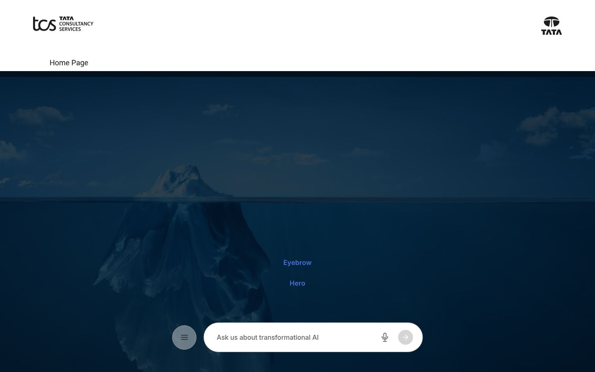

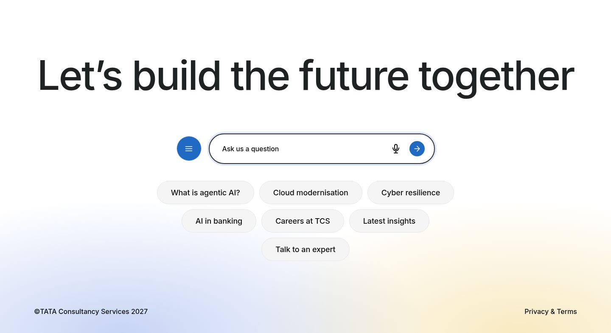

---

## 2. Edit the header (nav page)

Open the **nav** page in Universal Editor. It holds up to three sections, in any order. The header recognises each one by what it contains:

| Section | Add these components | Becomes |
|---|---|---|
| Logos | Two **Image** components | Company logo (links to the home page) and group mark |
| Menu | One **Text** component with a bulleted list of links | The menu that opens from the menu button |
| Ask bar | One **Ask** block | The floating ask bar at the bottom of the screen |

This is the nav page as you see it while editing. The styling only appears in the real header:

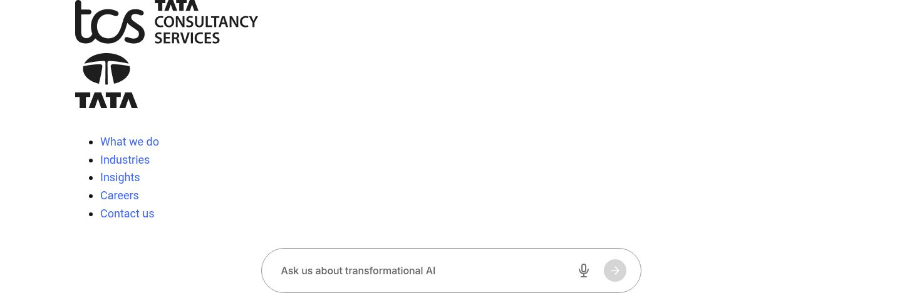

### Header anatomy

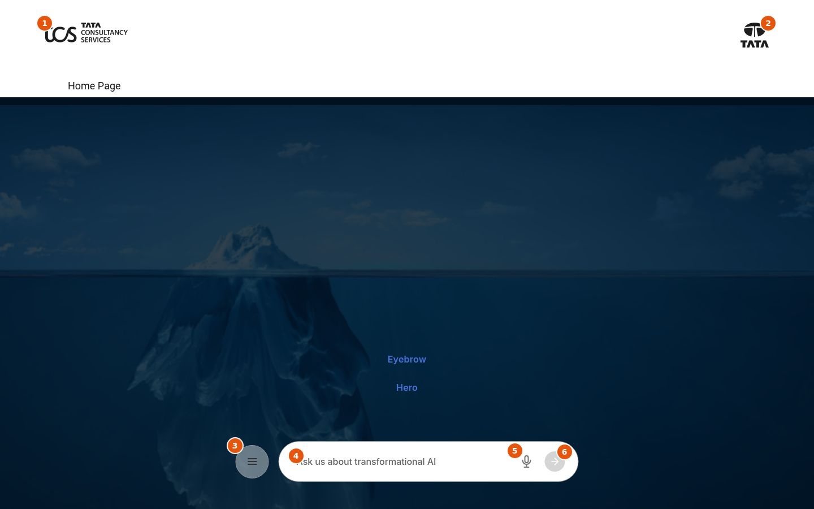

| # | Part | Where to change it |
|---|---|---|
| 1 | Company logo | First **Image** in the logos section. Its **Alt Text** names the home link, e.g. "Tata Consultancy Services" |
| 2 | Group mark | Second **Image** in the logos section. Alt Text, e.g. "Tata group" |
| 3 | Menu button | Added automatically. Opens the menu |
| 4 | Prompt text | **Ask** block → **Prompt Text** |
| 5 | Voice input | Added automatically, in browsers that support speech input |
| 6 | Send | Added automatically. Grey until a question is typed |

### Logos

- Upload the logos to Assets and choose them in the **Image** components. The header sets their height (35px on desktop, 31px on smaller screens), so any width works.
- The first logo links to the site's home page. To link it somewhere else, add a **Button** to the logos section with the target page. It isn't shown; only its link is used.

### Menu links

Add a **Text** component to the menu section and write a bulleted list where every item is a link:

- **Simple menu:** one level of links, as on the current site.
- **Grouped menu:** an item that isn't a link, with an indented list under it, becomes a group. Its text shows as a small grey label above its links.

When opened, the menu shows the links in one column on mobile and three columns on wider screens:

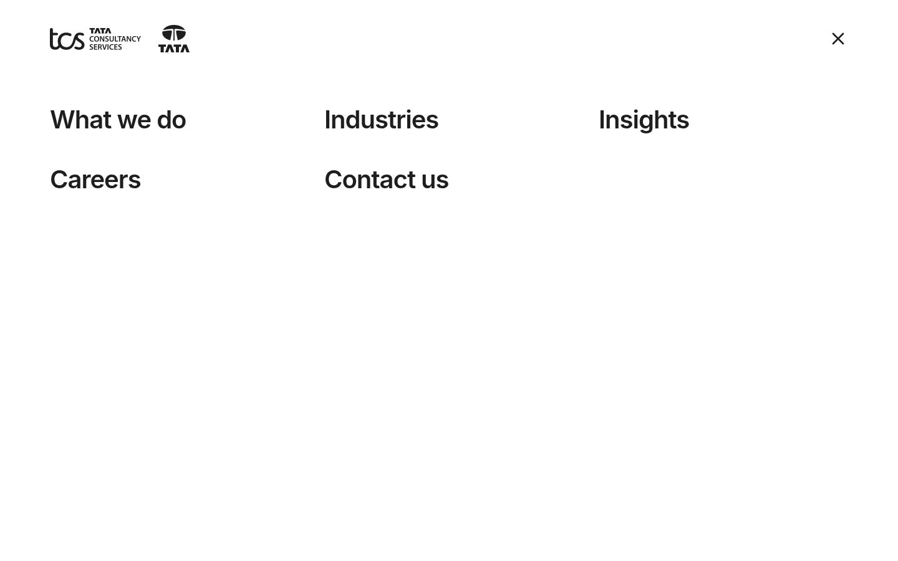

---

## 3. The Ask block

The **Ask** block is the question bar. The nav page uses it for the floating bar and the footer page for its large bar. It can also be added to any normal page section.

| Field | Notes |
|---|---|
| Prompt Text | Required, up to 60 characters. Shown in the empty input and read out by screen readers as the input's label |
| Answer Page | The page that answers questions. The question is added to its address as `?q=…`. Leave it empty until an answer page exists; the question then reloads the current page |
| Suggested Questions | Optional bulleted list. Each item becomes a chip that asks that question when clicked |

When a visitor types, the send button turns blue:

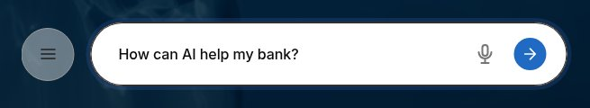

---

## 4. Edit the footer (footer page)

Open the **footer** page in Universal Editor. It has two sections:

| Section | Add these components |
|---|---|
| Top (call to action) | A **Title** (use Heading 2) and an **Ask** block with **Suggested Questions** |
| Bottom row | A **Text** component: the copyright line, then the links (e.g. "Privacy & Terms") |

The section holding the Ask block becomes the top area. Every other section becomes the bottom row.

This is the footer page as you see it while editing:

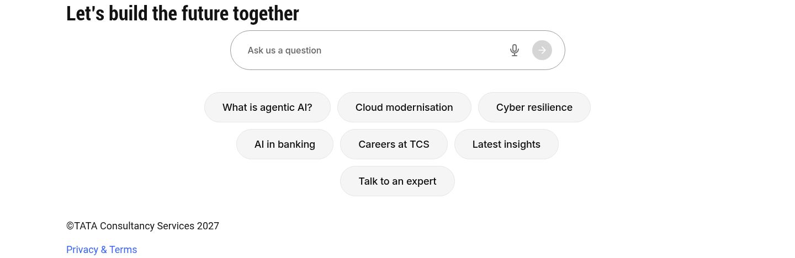

### Footer anatomy

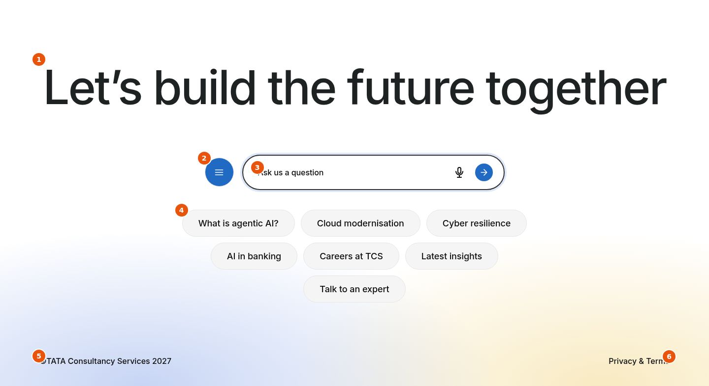

| # | Part | Where to change it |
|---|---|---|
| 1 | Heading | **Title** component, e.g. "Let's build the future together" |
| 2 | Menu button | Added automatically. Opens the same menu as the header |
| 3 | Prompt text | **Ask** block → **Prompt Text**, e.g. "Ask us a question" |
| 4 | Suggested questions | **Ask** block → **Suggested Questions**, one bullet per chip |
| 5 | Copyright | First paragraph of the bottom-row **Text** |
| 6 | Links | Links in the bottom-row **Text**. A link authored as a **Button** is still shown as a plain link |

Tips:
- Keep chips to a few words each. About 6 to 8 chips fit the design.
- Update the copyright year in the bottom-row text.

---

## 5. Use a different header or footer on a page

By default every page uses `/nav` and `/footer`. To give a page, or a microsite, its own header or footer:

1. Create another nav or footer page with the same structure (sections 2 and 4).
2. Open the page's **Properties** and choose that page in **Navigation** or **Footer**.

Leave the fields empty to use the defaults.

---

## 6. How visitors use it

- **Floating ask bar:** stays at the bottom of the screen while visitors read. It fades away once the footer comes into view, because the footer has its own ask bar:

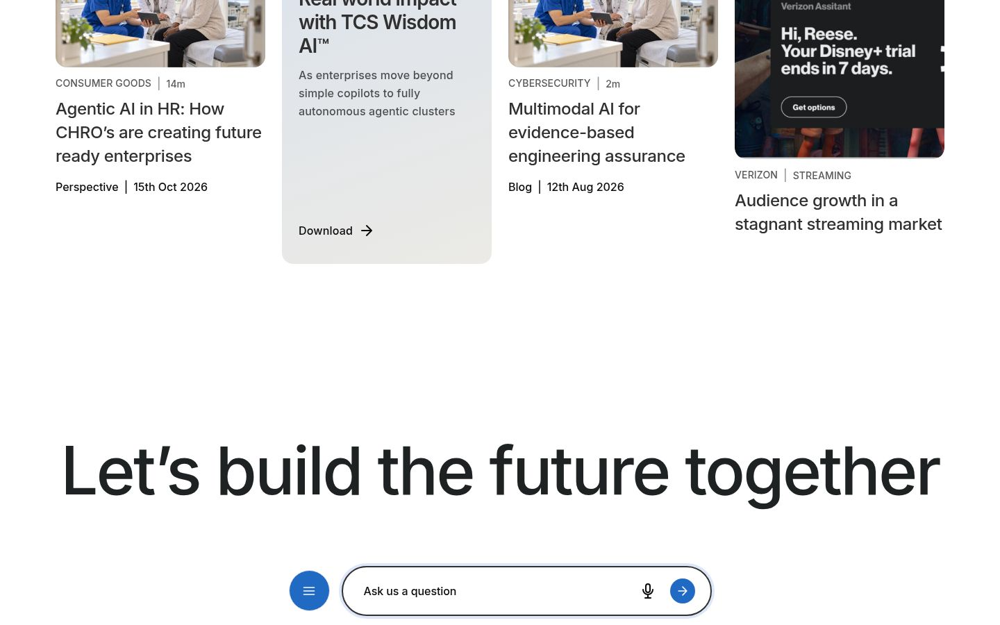

- **Menu:** opens from the menu button in the floating bar, the menu icon in the header (tablet and mobile), or the footer's menu button. It covers the whole screen and closes with the **×** button, the **Esc** key, or by choosing a link.
- **In Universal Editor:** the floating bar stays below the header instead of floating, so it never covers the content you're editing.

---

## 7. Tablet and mobile

Nothing needs to be set for smaller screens. On tablet and mobile both logos sit on the left and a menu icon appears on the right.

**Tablet:** the floating bar keeps its menu button.

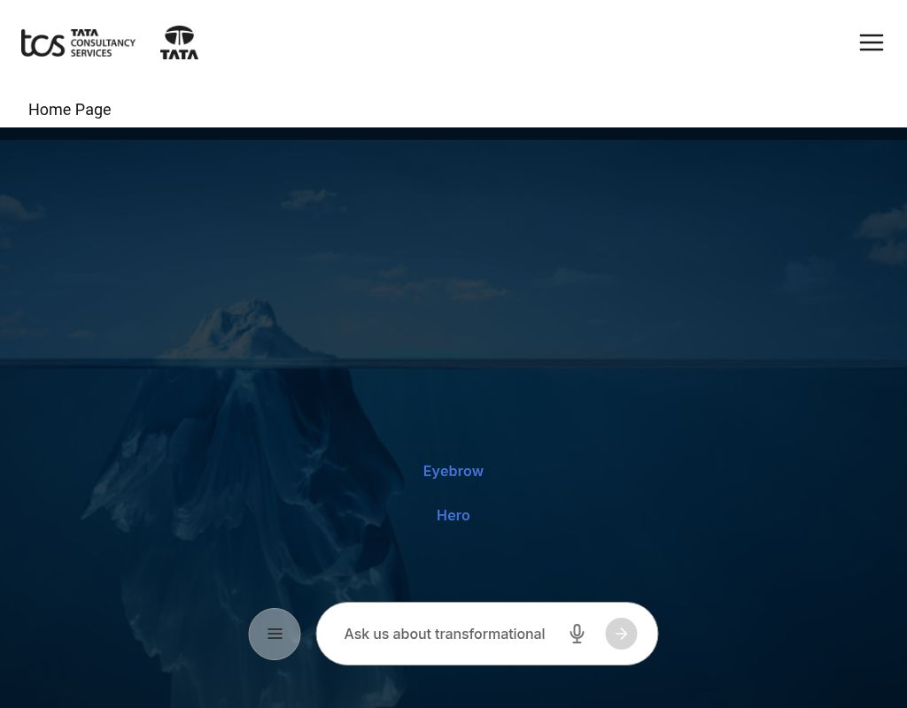

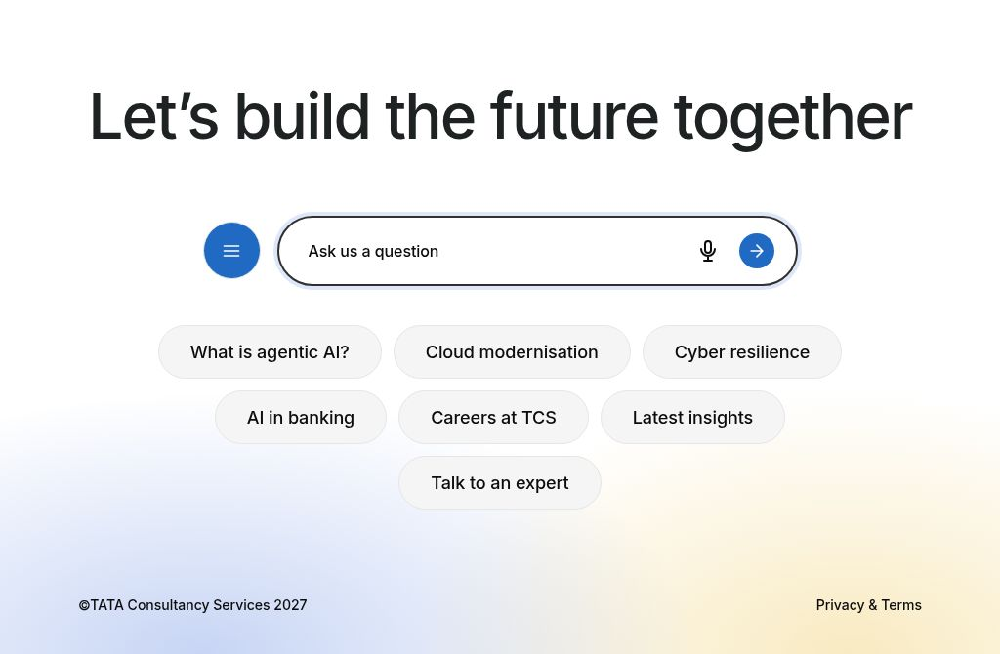

**Mobile:** the floating bar and the footer's ask bar drop their menu button, because the header's menu icon is always available.

| Header | Menu | Footer |
|---|---|---|
| 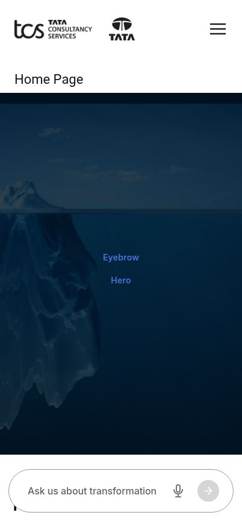 |  |  |

---

## 8. Publish changes

1. Edit the **nav** or **footer** page.
2. Publish that page (Quick Publish, or Manage Publication). Preview first if your workflow uses it.

Every page picks up the change; there's no need to republish other pages.

---

## 9. Accessibility checklist

Built in:
- The header is announced as the main navigation, and the ask bars as search areas with labelled inputs.
- The menu is a true dialog: keyboard focus moves into it, stays inside while it's open, and returns to the button that opened it.
- Buttons announce what they do ("Open menu", "Close menu", "Ask by voice", "Send question"), and the header's menu buttons say whether the menu is open.
- The floating bar is skipped by the keyboard while it's hidden near the footer.
- Visible blue focus outlines throughout.

Authors should:
- Give the first logo **Alt Text** with the company name. It names the home link.
- Write **Prompt Text** as a short instruction, e.g. "Ask us a question".
- Write menu link text that describes the destination, e.g. "Careers", not "Click here".
- Keep the footer heading as a **Heading 2**.

---

## 10. Troubleshooting

| Situation | What to do |
|---|---|
| The header shows no logo | Add an **Image** to the logos section of the nav page, then publish the nav page |
| There's no floating ask bar | Add an **Ask** block to the nav page. Without it, the menu icon shows in the header instead |
| A menu item isn't clickable | Make sure the list item is a link. Items that aren't links become group labels |
| The menu shows "Examples, Getting Started…" | The published nav page still has the old boilerplate content. Publish the new nav page |
| Questions go nowhere | Set **Answer Page** on the Ask block |
| No microphone button | It only appears in browsers that support speech input, e.g. not Firefox |
| A page shows a different header | Check the page's **Properties** → **Navigation** |
| "Privacy & Terms" looks like a button | It's shown as a plain link in the footer. If not, check it's in the bottom-row section, not the top one |

To view the sandbox locally: `npx aem up --html-folder drafts --prefer-plain-html --port 3001`, then open `/drafts/header-footer` (full header and footer) and `/drafts/header-no-ask` (header without an ask bar).
