# List: Authoring Guide

**Audience:** content authors and reviewers in AEM Universal Editor. Developers: see `blocks/list/README.md` and `docs/design/design-analysis.md`.

**About the screenshots:** they show the block as rendered in the local preview. The Universal Editor interface itself (Content Tree, Add menu, properties panel) can't be captured from this environment, so those steps are described in text. Numbered orange badges in the anatomy screenshots were added for this guide; they don't appear on the page.

**Status:** tested in the local preview at desktop, tablet and mobile widths. Still to confirm in your AEM author environment: List, Theme card and Insight card appearing under Add, and editing titles directly on the canvas.

---

## Contents

1. [What the List block is](#1-what-the-list-block-is)
2. [Add a List](#2-add-a-list)
3. [List settings](#3-list-settings)
4. [Themes variation](#4-themes-variation)
5. [Insights variation](#5-insights-variation)
6. [Reorder, duplicate and delete cards](#6-reorder-duplicate-and-delete-cards)
7. [New and partly filled cards](#7-new-and-partly-filled-cards)
8. [Tablet and mobile](#8-tablet-and-mobile)
9. [Accessibility checklist](#9-accessibility-checklist)
10. [Troubleshooting](#10-troubleshooting)

---

## 1. What the List block is

A **List** is a section heading, an optional link next to it, and a set of cards. It comes in two variations, taken from the Figma design:

**Themes**: a row of four theme cards.

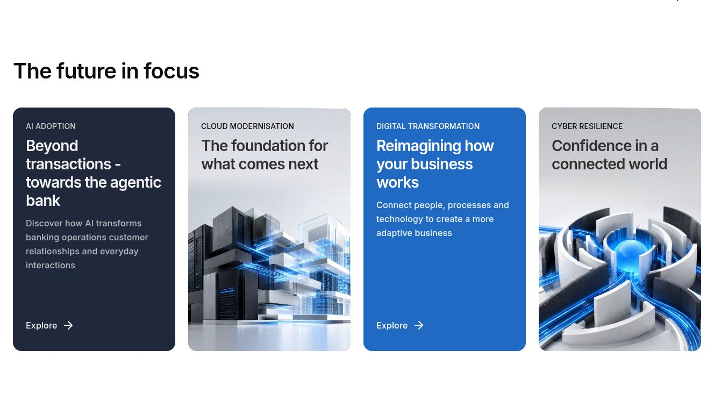

**Insights**: a large featured card followed by supporting cards (articles, reports, case studies).

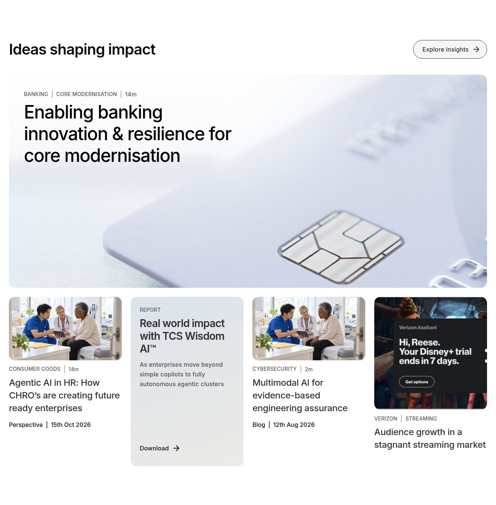

```
List                         ← the block: Variation, Heading, Header Link
├── Theme card / Insight card
├── Theme card / Insight card
└── …
```

Every card is clickable as a whole. Visitors don't have to hit the small link.

---

## 2. Add a List

1. Open the page in **Universal Editor**.
2. In the Content Tree, select the **section** where the List should go. Any section works, including a tab inside a **Tabs** container.
3. Click **Add (+)** → **List**. It's added with the heading "Section heading" and no cards.
4. With **List** selected, choose the **Variation** and type the **Heading** (see section 3).
5. Select the List and click **Add (+)** → **Theme card** or **Insight card**, once per card.

---

## 3. List settings

Select the **List** block and set:

| Field | Notes |
|---|---|
| Variation | **Themes** or **Insights**. Defaults to Themes |
| Heading | Required, up to 80 characters, e.g. "The future in focus" |
| Header Link | Optional page or URL, e.g. the insights listing |
| Header Link Text | e.g. "Explore insights", up to 40 characters |

On desktop the header link is a rounded button to the right of the heading. On smaller screens it's a plain arrow link. Leave both header link fields empty to show only the heading.

---

## 4. Themes variation

Use **Theme cards** in a Themes list. The design shows four.

### Card anatomy

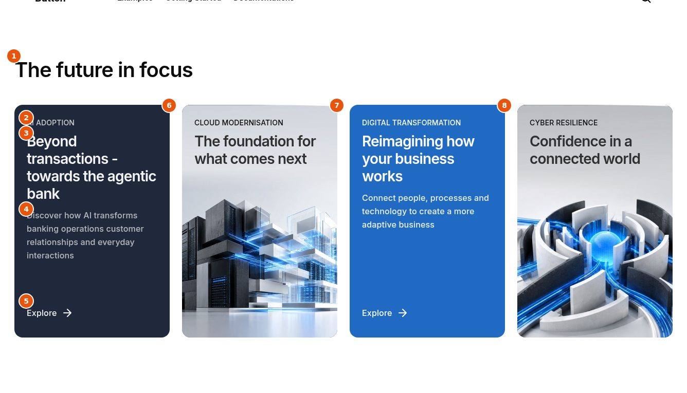

| # | Field | Notes |
|---|---|---|
| 1 | Heading | Set on the List (section 3) |
| 2 | Eyebrow | Short label shown in capitals, e.g. "AI adoption" (up to 40 characters) |
| 3 | Title | Required, up to 90 characters. About 50 fits the design best |
| 4 | Description | Optional, up to 180 characters |
| 5 | Link + Link Text | The whole card links here. Link Text defaults to "Explore" |
| 6 | Card Colour: **Dark** | Used when the card has no background image |
| 7 | Background Image (+ Alt Text) | Turns the card into an image card with dark text |
| 8 | Card Colour: **Brand blue** | The second colour in the design |

### The three looks

| Dark | Brand blue | Image |
|---|---|---|
| 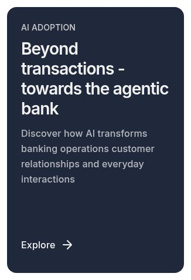 | 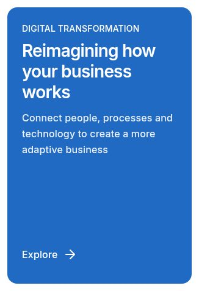 | 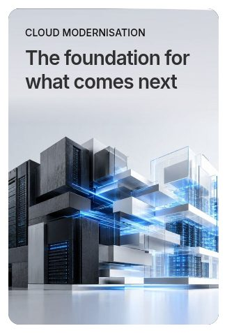 |

- **Without an image**, pick a **Card Colour**. The design alternates Dark and Brand blue.
- **With an image**, the colour setting is ignored, the text turns dark, and the "Explore" link is hidden; the title becomes the link instead. Choose images with a calm, light area at the top so the text stays readable.

---

## 5. Insights variation

Use **Insight cards** in an Insights list. Set each card's **Card Type** first. It decides which fields are shown and how the card looks.

### Card anatomy

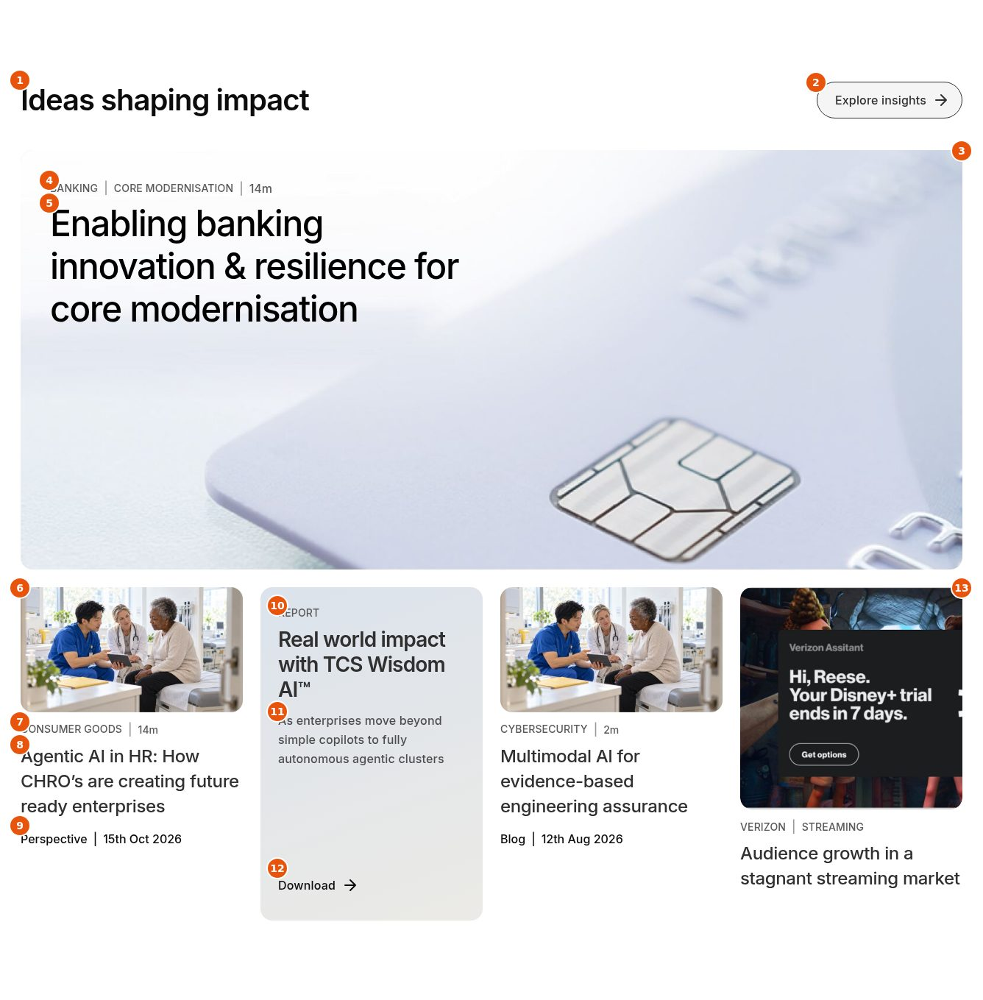

| # | Field | Card types | Notes |
|---|---|---|---|
| 1 | Heading | – | Set on the List |
| 2 | Header Link + Text | – | Set on the List, e.g. "Explore insights" |
| 3 | Card Type: **Featured** | Featured | Full-width card, the image is the background |
| 4 | Tags + Read Time | Featured | Tags are comma separated, e.g. "Banking, Core modernisation". Read Time e.g. "14m" |
| 5 | Title | Featured | Required on every card type, up to 120 characters |
| 6 | Image (+ Alt Text) | Article, Case study, Featured | Not shown on Report cards |
| 7 | Tags + Read Time | Article | Shown above the title |
| 8 | Title | Article | The title is the card's link |
| 9 | Content Type + Date | Article | Footer line, e.g. "Perspective \| 15th Oct 2026" |
| 10 | Tags | Report | Shown as the label, e.g. "Report" |
| 11 | Description | Report | Up to 180 characters |
| 12 | Link Text | Report | Visible link, e.g. "Download" (defaults to "Read more") |
| 13 | Card Type: **Case study** | Case study | Square image |

**Link** (all types): the page the whole card opens. Only Report cards show the link text; on the others the title is the link.

### Card types

**Featured**

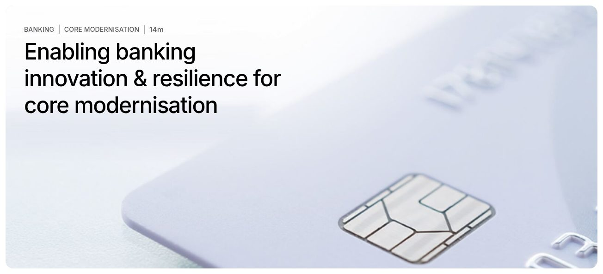

| Article | Report | Case study |
|---|---|---|
| 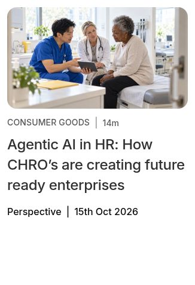 | 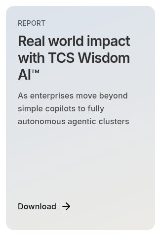 | 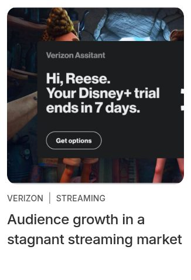 |

| Card Type | Use for | Fill in |
|---|---|---|
| **Featured** | The lead story | Image, Tags, Read Time, Title, Link |
| **Article** | Blogs, perspectives | Image, Tags, Read Time, Title, Link, Content Type, Date |
| **Report** | Downloads, reports | Tags (e.g. "Report"), Title, Description, Link, Link Text |
| **Case study** | Client stories | Image, Tags (e.g. "Verizon, Streaming"), Title, Link |

**Recommended layout** (as in the design): one **Featured** card first, then four supporting cards. A Featured card always takes a full row; supporting cards sit four per row on desktop and wrap to a new row after four.

Write dates exactly as they should appear, e.g. "15th Oct 2026". They're shown as typed.

---

## 6. Reorder, duplicate and delete cards

| I want to… | Do this |
|---|---|
| **Reorder** cards | Drag the card in the Content Tree |
| **Duplicate** a card | Duplicate it in the Content Tree, then change its text and image |
| **Delete** a card | Select it and delete it |
| **Switch** Themes ↔ Insights | Change **Variation** on the List. Then replace the cards with the matching card type (Theme cards for Themes, Insight cards for Insights) |
| **Turn** an Article into a Report | Change **Card Type**, then fill in Description and Link Text |

In the editor, clicking a card selects it for editing (the whole-card link only works on the published page). Edit a card's fields in the properties panel. Text such as titles can also be edited on the canvas.

---

## 7. New and partly filled cards

New cards start with the title "Card title". Empty fields are simply left out, so a card never shows empty boxes or placeholder text.

**Themes**: a new Dark card, a new Brand blue card, and a card with a link but no link text ("Explore" is used):

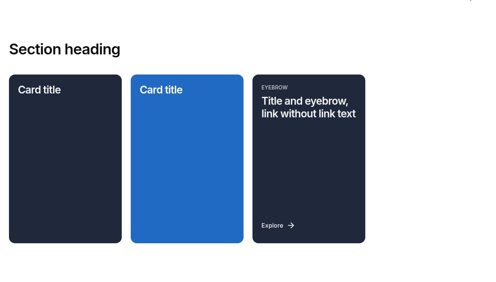

**Insights**: a new Article card, an Article without an image, and a Report with a link but no link text ("Read more" is used):

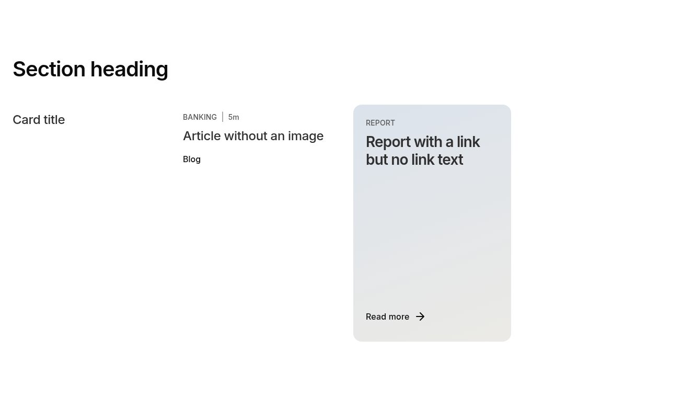

---

## 8. Tablet and mobile

Nothing needs to be set for smaller screens. The List adapts on its own.

**Tablet** (landscape, as in the design): both variations keep four cards per row. Cards grow taller to fit their text. On narrower tablets (portrait), Themes cards swipe as on mobile and Insights cards sit two per row.

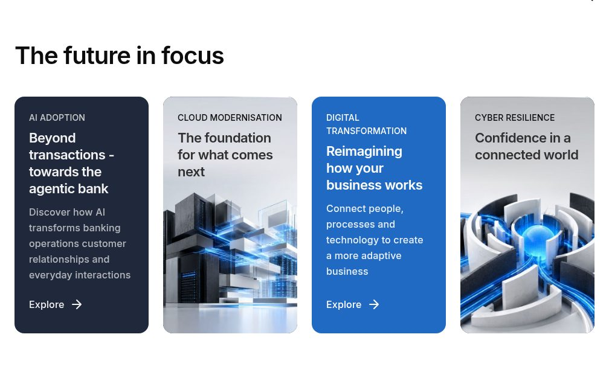

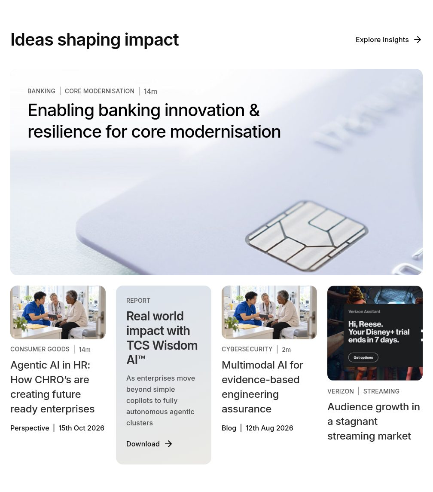

**Mobile, Themes**: the cards become a swipeable row. The bar below shows how far the visitor has swiped.

| Start | After swiping |
|---|---|
| 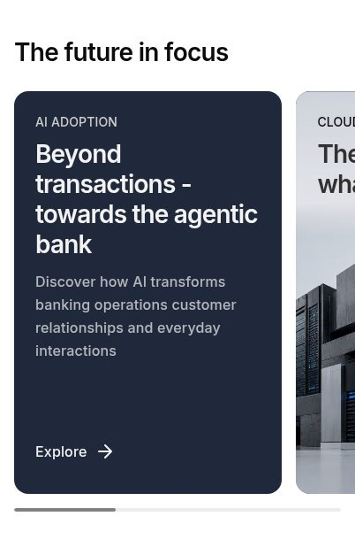 | 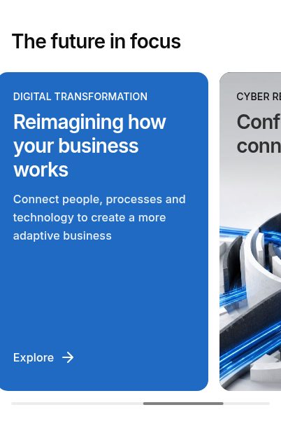 |

**Mobile, Insights**: cards stack in one column, and the header link moves below the heading.

| Top | Continued | End |
|---|---|---|
| 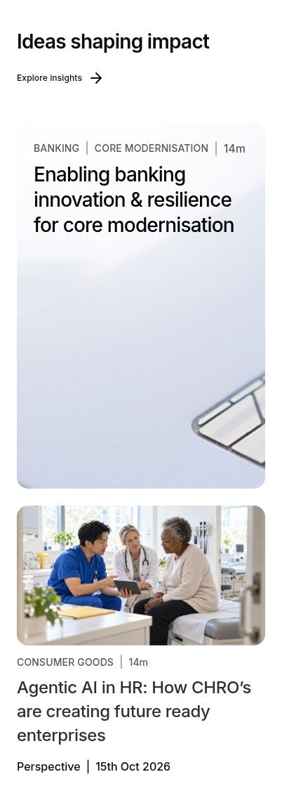 | 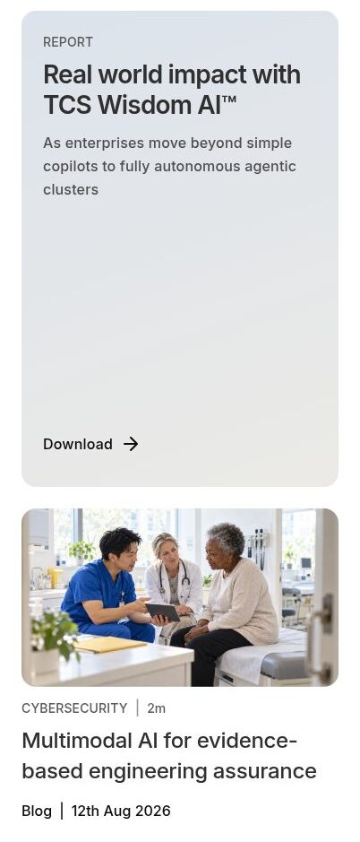 | 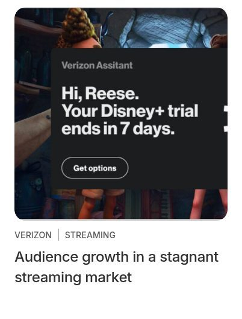 |

---

## 9. Accessibility checklist

Built in:
- The heading is announced as a heading, and each card title as a sub-heading.
- Cards are announced as a list ("list, 4 items").
- "Explore" and "Download" links are read together with the card title, so they make sense on their own.
- The "|" dividers are skipped by screen readers. Read time is announced as "Read time 14m".
- Keyboard users can tab through every card, with a visible blue outline around the whole card:


Authors should:
- Write a short, unique **Heading** and **Title** for every card.
- Add **Alt Text** for images that carry meaning (e.g. a product screen). Leave it empty for decorative images.
- Use images with a light, calm area behind the text on image cards and Featured cards.
- Write link text that says what happens, e.g. "Download" for a PDF report.

---

## 10. Troubleshooting

| Situation | What to do |
|---|---|
| **List** isn't in the Add menu | Select a **section** (not the page or another block) and click **Add (+)** again. If it's still missing, reload the editor |
| **Theme card** / **Insight card** isn't offered | Select the **List** block itself, then **Add (+)** |
| Cards look wrong for the variation | Theme cards belong in **Themes**, Insight cards in **Insights**. Check the List's **Variation** |
| The "Explore" link doesn't show | The card has a background image, so the title is the link. That's by design |
| The image doesn't show on a card | Report cards never show an image. Change **Card Type** to Article or Case study |
| A featured card isn't full width | Set its **Card Type** to **Featured** |
| Tags run together in one label | Separate tags with commas: "Banking, Core modernisation" |
| Text is hard to read on an image | Choose an image with a lighter area behind the text |

To view the sandbox locally: `npx aem up --html-folder drafts --prefer-plain-html --port 3001`, then open `/drafts/list` (both variations) and `/drafts/list-states` (new and partly filled cards).
