# Tabs Block: Authoring Guide

**Audience:** content authors and reviewers working in AEM Universal Editor. Developers: see `blocks/tabs/README.md` for the technical documentation.

**About the screenshots:** the images show the rendered result of the sandbox pages in `drafts/` (local preview). The two "editor" images show the hints the block displays inside Universal Editor. The Universal Editor interface itself (Content Tree, Add menu, properties panel) can't be captured from this environment, so those steps are described in text.

**Status:** tested in the local preview. Still to confirm in your AEM author environment: tab switching when you select a Tab in the Content Tree, the *Auto Rotation Speed* field appearing only when rotation is on, and how Tab items are stored in AEM.

---

## Contents

1. [How tabs work](#1-how-tabs-work)
2. [Create Tabs](#2-create-tabs)
3. [Add, rename, reorder, duplicate, disable and delete tabs](#3-add-rename-reorder-duplicate-disable-and-delete-tabs)
4. [Add blocks to a tab](#4-add-blocks-to-a-tab)
5. [Configure icons, badges, themes and styles](#5-configure-icons-badges-themes-and-styles)
6. [Examples](#6-examples)
7. [Mobile and tablet](#7-mobile-and-tablet)
8. [Links to a tab, history and analytics](#8-links-to-a-tab-history-and-analytics)
9. [Accessibility checklist](#9-accessibility-checklist)
10. [Moving older tabs to fragments](#10-moving-older-tabs-to-fragments)
11. [Troubleshooting](#11-troubleshooting)

---

## 1. How tabs work

```
Tabs                                    ← managed entirely here
 ├─ Tab "Overview"  → Tab Content: /fragments/products/overview   (Hero, Text, CTA…)
 ├─ Tab "Features"  → Tab Content: /fragments/products/features   (Cards, Columns…)
 └─ Tab "Resources" → Tab Content: /fragments/products/resources  (downloads, quote…)
```

- The **Tabs** block holds the heading and how the tabs look and behave.
- Each **Tab** inside it holds the tab's title and settings, plus a **Tab Content** link to a **fragment page**.
- The fragment page is where the tab's blocks live. It accepts **any block in the project**, including blocks added in future, and they look exactly as they do anywhere else.

Edge Delivery doesn't allow blocks to be placed directly inside another block, so a tab's blocks live in its fragment page. Only the open tab's fragment loads with the page; other tabs load when a visitor opens them, which keeps pages fast.

---

## 2. Create Tabs

1. Open the page in **Universal Editor**.
2. Select a section and click **Add (+)** → **Tabs**.
3. With the Tabs block selected, set its properties: **Heading**, **Description**, **Tab Style**, **Orientation**, **Alignment**, **Mobile Behaviour**, **Theme Variant**, **Tab Size**, and the toggles (**Enable Icons**, **Deep Linking**, **Sticky Tabs**, **Auto Rotation**).

Until it has tabs, the block shows this hint in the editor (visitors never see it):

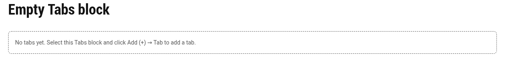

---

## 3. Add, rename, reorder, duplicate, disable and delete tabs

| I want to… | Do this |
|---|---|
| **Add** a tab | Select the Tabs block → **Add (+)** → **Tab**. It's added as "New Tab". |
| **Rename** a tab | Select the Tab → change **Title** |
| **Reorder** tabs | Drag Tabs up or down inside the Tabs block in the **Content Tree** |
| **Duplicate** a tab | Select the Tab → **Duplicate** in the editor toolbar, then change its Title and Tab ID |
| **Disable** a tab | Turn on **Disabled** (shown greyed out; can't be opened) |
| Open a tab **first** | Turn on **Default Active** (the first one turned on wins) |
| **Delete** a tab | Select the Tab → delete it |

A new tab without content shows this hint in the editor until you set its **Tab Content**:

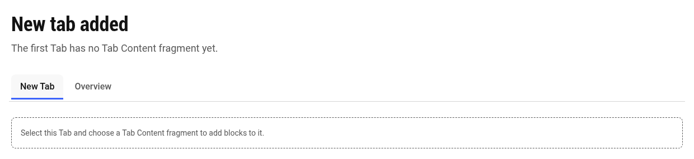

### Tab settings (properties panel → "Tab")

| Field | Notes |
|---|---|
| Title | Text on the tab (required, up to 60 characters) |
| Tab Content (fragment) | The fragment page with this tab's blocks |
| Tab ID | Name used in links, e.g. `security` gives `/products#security`. Defaults to the title. |
| Icon | Icon name from `/icons`, e.g. `info`, `star`, `chat` |
| Badge | Short label, e.g. "New" |
| Description | Shown on Card, Image and Mega styles |
| Thumbnail | Shown on the Image style |
| Analytics Label | Sent with analytics events for this tab |
| Default Active / Disabled | See the table above |

The **Legacy content** tab in the properties panel holds the older heading, image and rich-text fields. See [section 10](#10-moving-older-tabs-to-fragments).

---

## 4. Add blocks to a tab

1. **Create the fragment page** in the Sites console, e.g. under `/content/<site>/fragments/<page>/` (one page per tab, named after the tab).
2. **Open the fragment page** in Universal Editor and add any blocks: Hero, Title, Text, Image, Cards, Columns, buttons, Fragment, and any block the project adds later. Use several sections if you like.
3. **Publish the fragment** whenever you publish the page that uses it.
4. **Back on the page**, select the Tab and set **Tab Content (fragment)** to that page.

> Fragments are reusable: the same fragment can be used by tabs on several pages, and an update shows everywhere it's used.

**Hero, text and button inside a tab:**

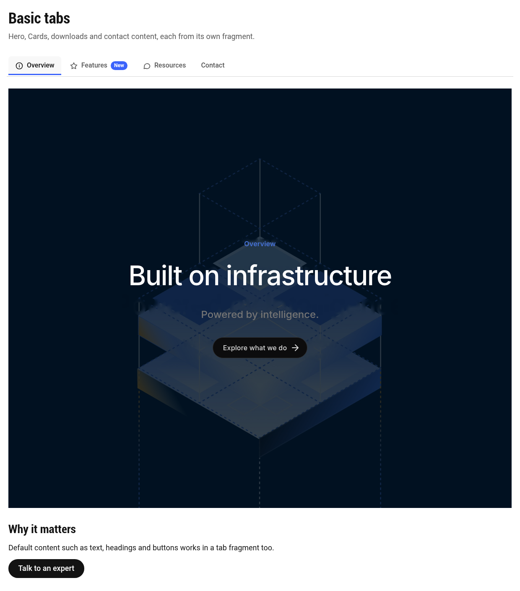

**Cards inside a tab** (loaded the first time the tab is opened):

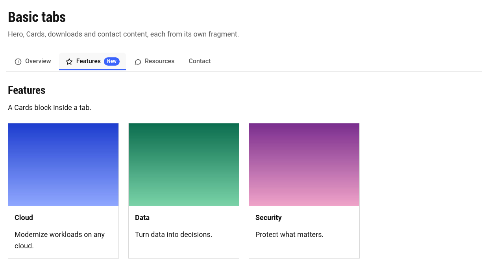

**Downloads list and quote inside a tab:**

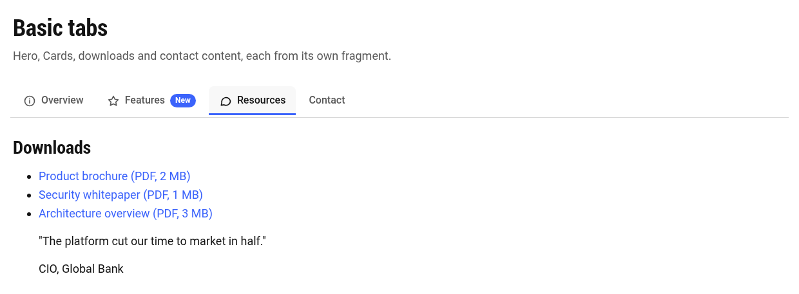

> Carousel, Accordion, Forms, Video and Map blocks don't exist in this project yet, so they aren't shown. Once added to the project, they work in tab fragments the same way: they start up when their tab first opens, at their visible size.

---

## 5. Configure icons, badges, themes and styles

| Setting | Where | Options |
|---|---|---|
| Icons | Tabs block: **Enable Icons** on, plus Tab **Icon** | Or use Tab Style **Icon** (icon above the label) |
| Badges | Tab **Badge** | Any short text |
| Theme | Tabs block **Theme Variant** | Light, Dark, Brand |
| Style | Tabs block **Tab Style** | Standard, Underline, Pill, Card, Icon, Numbered, Image, Mega |
| Orientation | Tabs block **Orientation** | Horizontal, Vertical (horizontal below desktop width) |
| Alignment | Tabs block **Alignment** | Start, Center, End, Full width (stretch) |
| Size | Tabs block **Tab Size** | Default, Compact |
| Sticky | Tabs block **Sticky Tabs** | Tab bar stays visible while scrolling long tabs |
| Auto rotation | Tabs block **Auto Rotation** + **Speed** | Pauses on hover and focus; off for reduced motion |

Themes change the tab bar and plain text inside tabs; blocks inside tabs keep their own design.

---

## 6. Examples

**Vertical tabs** with a disabled tab (Underline style, mobile dropdown):

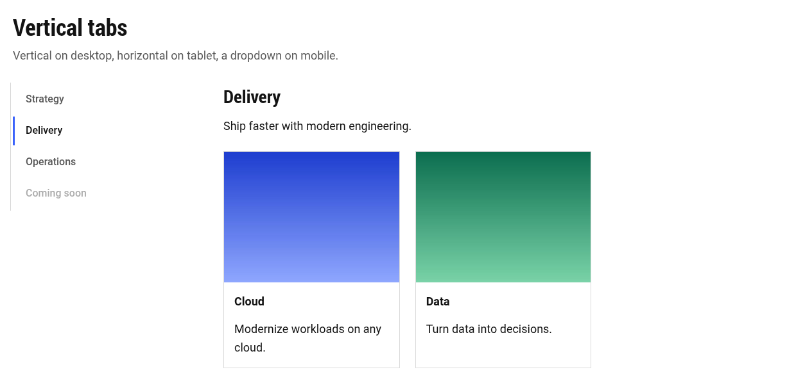

**Dark theme**: Pill tabs, with Hero, Cards and Columns in one tab:

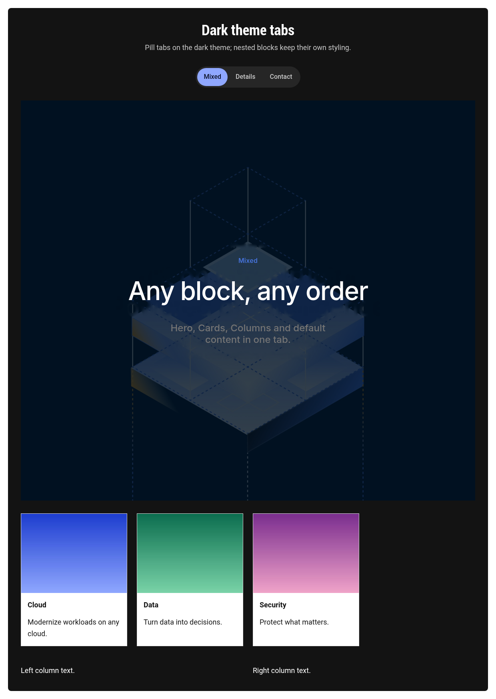

**Brand theme**: Icon tabs with a badge:

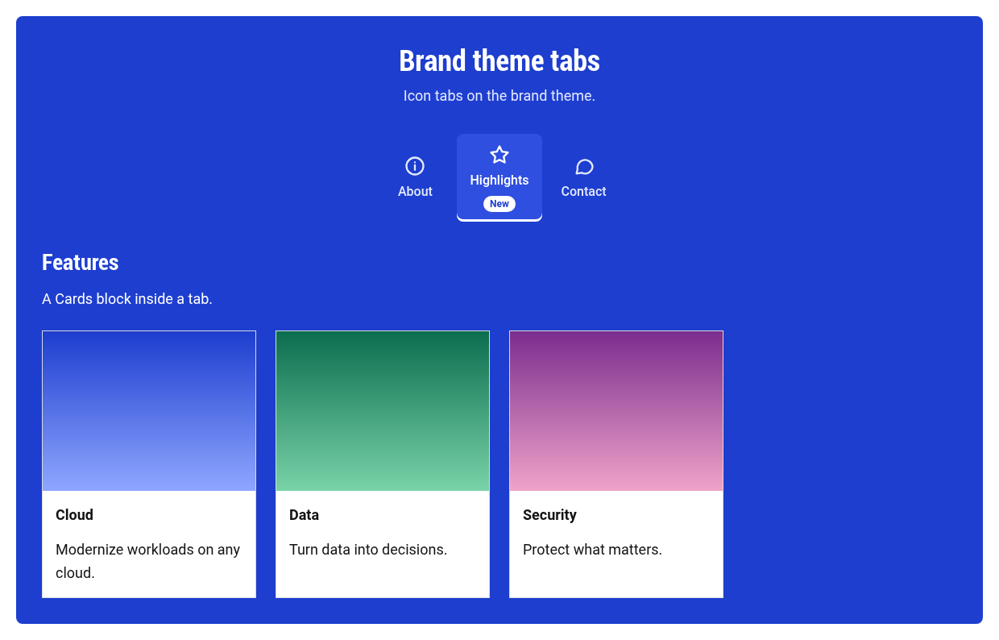

**Compact, full-width** tabs (Tab Size Compact, Alignment Full width):

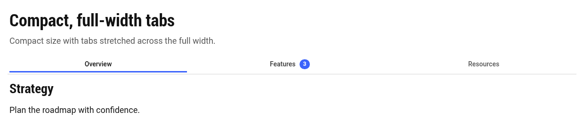

**Mega tabs**: a Hero inside the tab spans the full page width:

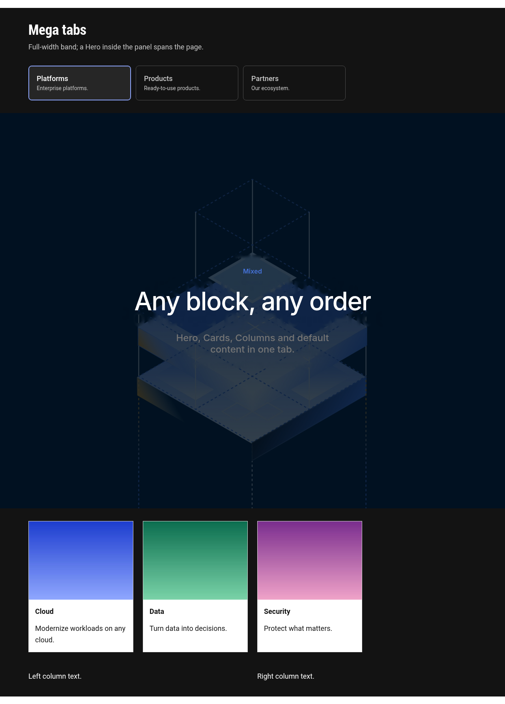

**Legacy tab**: an older tab using the inline fields, still rendering:

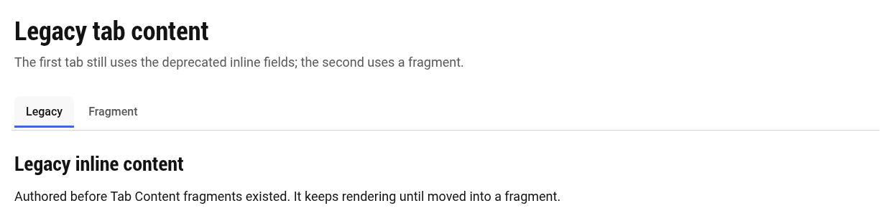

---

## 7. Mobile and tablet

Choose **Mobile Behaviour** on the Tabs block (below 600px):

**Accordion**: each tab becomes a collapsible heading, and its content loads when opened.

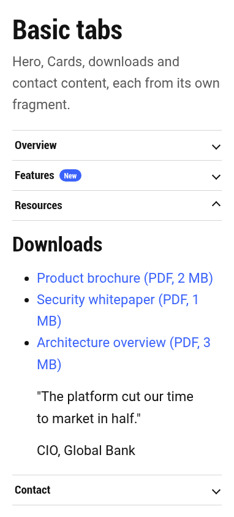

**Dropdown**: a select menu replaces the tab bar.

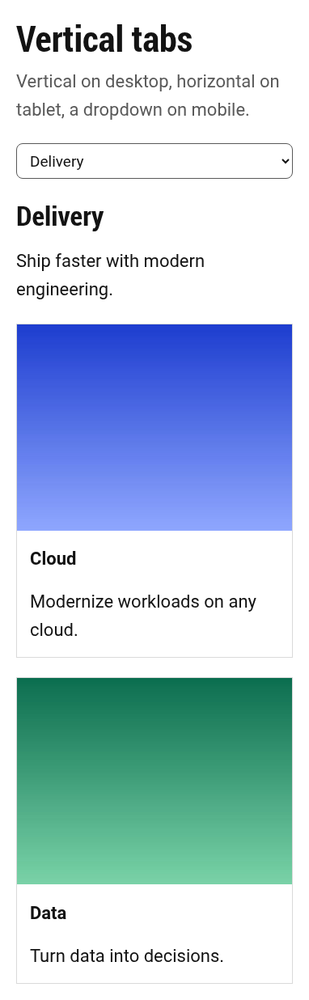

**Scrollable tabs**: the tab bar scrolls sideways.

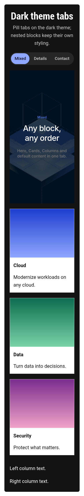

On tablets (600–899px), tabs are horizontal and scroll sideways when needed. Vertical tabs switch to horizontal:

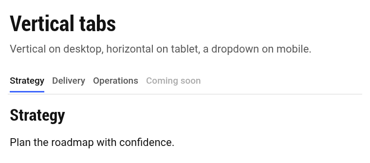

---

## 8. Links to a tab, history and analytics

- With **Deep Linking** on, the address bar shows the open tab (`/products#security`). Sharing or reloading that link opens the same tab, and the browser's **Back/Forward** buttons step through tabs.
- Link to a tab from anywhere with its **Tab ID**: `/products#security`.
- Analytics events (tab viewed, clicked, activated, changed) are sent automatically with the page name, tab name, position and your **Analytics Label**. No authoring is needed beyond setting a label if your analytics team asks for one.

---

## 9. Accessibility checklist

Built in: correct tab semantics for screen readers, keyboard support (arrow keys move between tabs, **Enter/Space** opens one, Home/End jump), announcements such as "Features tab selected, 2 of 4", disabled tabs announced as unavailable, visible focus:

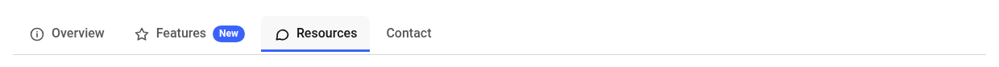

Authors should:
- Give the Tabs block a **Heading**, which names the tab bar for screen readers.
- Write short, unique tab **Titles**.
- Start fragment content with headings one level below the Tabs heading (e.g. H3 under an H2).
- Add alt text to meaningful images in fragments.
- Use **Auto Rotation** only for non-essential showcase content.

---

## 10. Moving older tabs to fragments

Tabs authored before Tab Content existed use the **Legacy content** fields (heading, image, rich text). They keep working with no action needed. To move one:

1. Create a fragment page and add the same content as **Title**, **Image** and **Text** (or any blocks).
2. Set the Tab's **Tab Content (fragment)** to it. The fragment replaces the legacy content straight away.
3. Clear the **Legacy content** fields.

Tab Panel sections from the earliest version are no longer recognised and show as normal sections. Recreate them as Tabs inside the Tabs block.

---

## 11. Troubleshooting

| Situation | What to do |
|---|---|
| "No tabs yet" hint | Select the Tabs block → **Add (+)** → **Tab** |
| "Choose a Tab Content fragment" hint | Select the Tab and set **Tab Content (fragment)** |
| Tab content says it could not be loaded | Check the fragment path, and that the fragment is published |
| **Tab** isn't in the Add list | Select the **Tabs block** itself, not the section |
| I want blocks directly under the Tab in the Content Tree | Not supported by Edge Delivery. Put the blocks in the tab's fragment page |
| Wrong tab opens on load | Check **Default Active**; a `#tab-id` in the URL takes priority |
| An icon doesn't show | Turn on **Enable Icons** (or use the Icon style) and check the icon name |

To view the sandbox locally: `npx aem up --html-folder drafts --port 3001`, then open `/drafts/tabs`, `/drafts/tabs-mega` and `/drafts/tabs-editor-states`.
