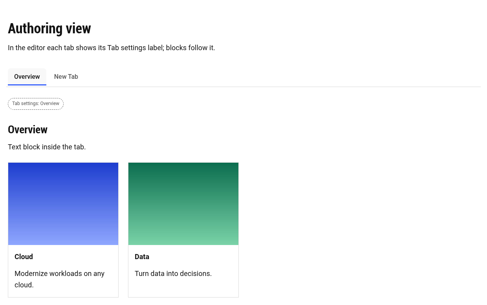

# Tabs: Authoring Guide

**Audience:** content authors and reviewers in AEM Universal Editor. Developers: see `docs/tabs/tabs-technical-guide.md`.

**About the screenshots:** they show the rendered sandbox pages from the local preview, including the hints and labels the Tabs container shows inside the editor. The Universal Editor interface itself (Content Tree, Add menu, properties panel) can't be captured from this environment, so those steps are described in text.

**Status:** tested in the local preview. Still to confirm in your AEM author environment: the Tabs container appearing under Add at page level, live updates after edits, and Content Tree selection opening the right tab.

---

## Contents

1. [How tabs are built](#1-how-tabs-are-built)
2. [Create Tabs](#2-create-tabs)
3. [Add a tab](#3-add-a-tab)
4. [Configure a tab](#4-configure-a-tab)
5. [Add blocks into a tab](#5-add-blocks-into-a-tab)
6. [Reorder, duplicate, disable and delete tabs](#6-reorder-duplicate-disable-and-delete-tabs)
7. [Themes and styles](#7-themes-and-styles)
8. [Mobile and tablet](#8-mobile-and-tablet)
9. [Links, history and analytics](#9-links-history-and-analytics)
10. [Accessibility checklist](#10-accessibility-checklist)
11. [Older Tabs blocks](#11-older-tabs-blocks)
12. [Troubleshooting](#12-troubleshooting)

---

## 1. How tabs are built

```
Tabs                              ← the container (added at page level)
├── Title, Text ................. optional intro above the tab bar
├── Tab "Overview" .............. the tab's settings
├── Hero, Text, Cards, CTA … .... Overview's content: any blocks
├── Tab "Features"
├── Cards, Columns … ............ Features' content
└── Tab "Resources"
    └── …
```

- **Tabs** is a container that works like a section: you can add **any block** to it, including blocks the project adds later.
- A **Tab** starts a new tab and holds its title and settings.
- **Everything after a Tab, up to the next Tab**, is that tab's content.

---

## 2. Create Tabs

1. Open the page in **Universal Editor**.
2. In the Content Tree, select the page's **Main** and click **Add (+)** → **Tabs**. The Tabs container is added to the page.
3. With **Tabs** selected, set **Tab Style**, **Orientation**, **Alignment**, **Mobile Behaviour**, **Theme Variant**, **Tab Size** and the toggles: **Enable Icons**, **Deep Linking**, **Sticky Tabs**, **Auto Rotation**.
4. Optionally add a **Title** and **Text** first. Anything before the first Tab is shown above the tab bar.

Until it has a Tab, the container shows this hint in the editor (visitors never see it):


---

## 3. Add a tab

1. Select the **Tabs** container and click **Add (+)** → **Tab**. It's added as "New Tab".
2. Place it where the tab should start: after the previous tab's content, or first in the container.

In the editor, each tab shows a small **"Tab settings"** label at the top of its content. Click it to select the Tab:



---

## 4. Configure a tab

Select the Tab (its settings label, or in the Content Tree) and set:

| Field | Notes |
|---|---|
| Tab Title | Text on the tab (required) |
| Tab ID | Used in links, e.g. `features` gives `/page#features`. Defaults to the title. |
| Description | Shown on Card, Image and Mega styles |
| Icon | Icon name from `/icons`, e.g. `info`, `star`, `chat` (turn on **Enable Icons**, or use the Icon style) |
| Badge | Short label, e.g. "New" |
| Thumbnail | Image shown on the Image style |
| Analytics Label | Sent with analytics events, e.g. `overview-tab` |
| Default Active | Opens this tab first (the first one turned on wins) |
| Disabled | Shown greyed out and can't be opened |

The page reloads in the editor after you change a Tab's settings, so the tab bar is rebuilt.

---

## 5. Add blocks into a tab

1. Select the **Tabs** container and click **Add (+)**: choose any block (Title, Text, Hero, Image, Cards, Columns, buttons, Fragment, and any block your project adds).
2. Drag the block in the Content Tree so it sits **after the tab's Tab and before the next Tab**.
3. Edit, reorder and configure the block exactly as you would anywhere else.

Selecting a block in the Content Tree opens its tab on the canvas.

**Hero, text and button inside a tab:**


**Cards inside a tab** (loaded the first time the tab opens):


**Downloads list and quote inside a tab:**


> Carousel, Accordion, Forms, Video and Map blocks don't exist in this project yet, so they aren't shown. Once added, they work in tabs the same way and start up when their tab first opens.

---

## 6. Reorder, duplicate, disable and delete tabs

| I want to… | Do this |
|---|---|
| **Reorder** tabs | Drag the Tab **and its blocks** to the new position in the Content Tree |
| **Rename** a tab | Change the Tab's **Tab Title** |
| **Duplicate** a tab | Duplicate the Tab and each of its blocks, then give the copy a new Title and Tab ID |
| **Disable** a tab | Turn on **Disabled** |
| Open a tab **first** | Turn on **Default Active** |
| **Delete** a tab | Delete the Tab and its blocks. If you delete only the Tab, its blocks join the previous tab |

---

## 7. Themes and styles

Set these on the **Tabs** container:

| Setting | Options |
|---|---|
| Tab Style | Standard, Underline, Pill, Card, Icon, Numbered, Image, Mega |
| Orientation | Horizontal, Vertical (horizontal below desktop width) |
| Alignment | Start, Center, End, Full width (stretch) |
| Theme Variant | Light, Dark, Brand |
| Tab Size | Default, Compact |
| Sticky Tabs | Tab bar stays visible while scrolling long tabs |
| Auto Rotation + Speed | Pauses on hover and focus; off for reduced motion |

Themes change the tab bar and plain text. Blocks inside tabs keep their own design.

**Vertical** (Underline style, one tab disabled):


**Dark theme** (Pill, centred) with Hero, Cards and Columns in one tab:


**Brand theme** (Icon style, badge):


**Compact, full-width** tabs:


**Mega**: a Hero inside the tab spans the full page width:


---

## 8. Mobile and tablet

Choose **Mobile Behaviour** on the Tabs container (below 600px):

**Accordion**: each tab becomes a collapsible heading.


**Dropdown**: a select menu replaces the tab bar.


**Scrollable tabs**: the tab bar scrolls sideways.


On tablets, tabs are horizontal and scroll sideways when needed. Vertical tabs switch to horizontal:


---

## 9. Links, history and analytics

- With **Deep Linking** on, the address shows the open tab (`/page#features`). Reloading or sharing the link opens that tab, and **Back/Forward** step through tabs.
- Link to a tab from anywhere with its **Tab ID**.
- Analytics events (viewed, clicked, activated, changed) are sent automatically with the page name, tab name, position and **Analytics Label**.

---

## 10. Accessibility checklist

Built in: screen-reader tab semantics, keyboard support (arrow keys move, **Enter/Space** open, Home/End jump), announcements like "Features tab selected, 2 of 4", disabled tabs announced as unavailable, visible focus:


Authors should:
- Start the container with a **Title**, which names the tab bar for screen readers.
- Write short, unique **Tab Titles**.
- Use headings one level below the intro heading inside tabs (e.g. H3 under H2).
- Add alt text to meaningful images.
- Use **Auto Rotation** only for non-essential showcase content.

---

## 11. Older Tabs blocks

Pages built with the older **Tabs (legacy)** block keep working, and look and behave the same:


The legacy block can no longer be added. To move a legacy tab into the new container:
1. Add a **Tabs** container next to the old block.
2. For each old tab, add a **Tab** with the same settings, then recreate its content as **Title**, **Image** and **Text** blocks (or any blocks).
3. Delete the old block.

Tab Panel sections from the first version show as normal sections. Recreate them as tabs in a Tabs container.

---

## 12. Troubleshooting

| Situation | What to do |
|---|---|
| "No tabs yet" hint | Select the Tabs container → **Add (+)** → **Tab** |
| "This tab is empty" hint | Add blocks after that Tab, before the next Tab |
| A block shows in the wrong tab | Drag it after the right Tab in the Content Tree |
| "A Tab only works inside a Tabs section" | The Tab was added to a normal section. Move it into a Tabs container |
| Wrong tab opens on load | Check **Default Active**; a `#tab-id` in the URL takes priority |
| An icon doesn't show | Turn on **Enable Icons** (or use the Icon style) and check the icon name |

To view the sandbox locally: `npx aem up --html-folder drafts --port 3001`, then open `/drafts/tabs`, `/drafts/tabs-mega`, `/drafts/tabs-editor-states` and `/drafts/tabs-legacy`.
