# Tabs Block: How It Was Built and How to Author It

**Audience:** content authors, reviewers and developers working on this site in AEM Universal Editor.

**About the screenshots:** every image in this guide is the rendered result of sample authored content (the sandbox page `drafts/tabs.plain.html`), captured in the local preview. They show what visitors see for each set of authoring choices. They are not screenshots of the Universal Editor interface itself.

**Status:** the published-page behaviour shown here was tested in the local preview. Two editor-only behaviours still need confirming in your AEM author environment: switching tabs when you select a Tab in the Content Tree, and showing *Auto Rotation Speed* only when rotation is on.

---

## Contents

1. [How the Tabs block was built](#1-how-the-tabs-block-was-built)
2. [The structure: one Tabs block with Tab items inside](#2-the-structure-one-tabs-block-with-tab-items-inside)
3. [Authoring tabs step by step](#3-authoring-tabs-step-by-step)
4. [Field reference](#4-field-reference)
5. [Variations, with settings and screenshots](#5-variations-with-settings-and-screenshots)
6. [Tablet and mobile behaviour](#6-tablet-and-mobile-behaviour)
7. [Accessibility: what is built in and what authors need to do](#7-accessibility-what-is-built-in-and-what-authors-need-to-do)
8. [Tips, limits and troubleshooting](#8-tips-limits-and-troubleshooting)
9. [Testing locally](#9-testing-locally)

---

## 1. How the Tabs block was built

### 1.1 Requirements

A reusable Tabs block where **all tabs are managed inside the Tabs block itself**: authors add, delete, reorder and rename tabs within the block in Universal Editor, choose a default tab, and author each tab's content inline. It also needed 10 visual variations, three mobile behaviours, deep linking, auto rotation and WCAG 2.2 AA accessibility.

### 1.2 The main design decision

Edge Delivery Services does not allow blocks or sections inside another block. Adobe's content-modeling rules say this explicitly ("No nested blocks for authors", in *David's Model* on aem.live). A block's children are always **items** (rows), not sections.

So the Tabs block is a **container block**, the same pattern as Adobe's Universal Editor tabs and cards blocks:

| Piece | What it is | What it holds |
|---|---|---|
| **Tabs** | The block you add to a section | Heading, description and all tab settings (style, alignment, mobile behaviour, theme…) |
| **Tab** | An item you add *inside* the Tabs block | The tab title, its settings (ID, icon, badge…) and the panel content: a heading, an image and rich text |

Each tab's content is **rich text** (paragraphs, headings, lists, links and buttons) plus an optional heading and image. Other blocks (Cards, Hero…) cannot be placed inside a tab.

> An earlier version used separate "Tab Panel" sections placed after the Tabs block so tabs could hold any block. It was replaced by this design so that everything is authored inside the Tabs block.

### 1.3 Build steps

1. **Content model** (`blocks/tabs/_tabs.json`): the Tabs block model (heading, description, rotation speed and 9 option fields), the Tab item model, and a filter that allows only Tab items inside Tabs. The editor configuration is regenerated with `npm run build:json`.
2. **Behaviour** (`blocks/tabs/tabs.js`): reads the Tab items, turns each into a tab button and panel, and handles clicks, the keyboard, URL hashes, auto rotation, the three mobile modes and the `tabs:change` analytics event. In Universal Editor it opens the tab you select in the Content Tree.
3. **Styling** (`blocks/tabs/tabs.css`): design tokens for colours, spacing and sizes; one rule group per tab style; themes that only swap tokens; panels with an image show it beside the text on desktop.
4. **Sample content and testing:** a sandbox page with 9 tab groups covering every variation, checked at desktop, tablet and mobile widths, with the keyboard, deep links, rotation and screen-reader names. `npm run lint` passes.

---

## 2. The structure: one Tabs block with Tab items inside

What the Content Tree looks like:

```
Section
├── (optional) other content
└── Tabs ............................ settings: style, alignment, mobile behaviour…
    ├── Tab "Overview" .............. title + settings + panel content
    ├── Tab "Features"
    └── Tab "Support"
```

- **Tab order = item order** inside the Tabs block.
- Everything stays inside the Tabs block; you never add anything outside it to create tabs.
- You can have several Tabs blocks on a page; each is independent.

---

## 3. Authoring tabs step by step

### 3.1 Add a Tabs block

1. Open the page in **Universal Editor**.
2. Select the section where the tabs should go and click **Add (+)** → **Tabs**.
3. With the Tabs block selected, set its properties in the panel on the right: **Heading**, **Description**, **Tab Style**, **Orientation**, **Alignment**, **Mobile Behaviour**, **Theme Variant** and the toggles (**Enable Icons**, **Deep Linking**, **Sticky Tabs**, **Auto Rotation**).

> Until it has tabs, the block shows a dashed hint in the editor: *"No tabs yet. Select this Tabs block and click Add (+) → Tab to add a tab."* Visitors never see this hint.

### 3.2 Add tabs

1. Select the **Tabs** block (on the canvas or in the Content Tree).
2. Click **Add (+)** → **Tab**. A tab called "New Tab" is added inside the block.
3. Repeat for each tab you need.

### 3.3 Fill in a tab

Select the **Tab** (in the Content Tree, under the Tabs block) and fill in:

- **Tab Title** (required): the text on the tab.
- **Panel Heading** and **Panel Heading Type** (H3 by default): the heading at the top of the panel.
- **Panel Image** and **Panel Image Alt Text** (optional): on desktop the image shows beside the text.
- **Panel Content**: rich text such as paragraphs, lists, links and buttons. Make a link a button by making it **bold** (primary) or *italic* (secondary).
- Optional tab settings: **Tab ID**, **Icon**, **Badge**, **Tab Description**, **Tab Image Thumbnail**, **Default Active**, **Disabled**, **Analytics Identifier**.

### 3.4 Manage tabs

| I want to… | Do this |
|---|---|
| Add a tab | Select the Tabs block → **Add (+)** → **Tab** |
| Delete a tab | Select the Tab and delete it |
| Reorder tabs | Drag Tabs up or down inside the Tabs block in the **Content Tree** |
| Rename a tab | Change the Tab's **Tab Title** |
| Open a specific tab first | Turn on **Default Active** on that Tab (the first active one wins) |
| Hide a tab temporarily | Turn on **Disabled** (shown greyed out, can't be opened) |
| Link to a tab | Use `#tab-id` in a link, e.g. `/services#cloud` |

> Tip: selecting a Tab in the Content Tree switches the canvas to that tab so you can see what you're editing.

---

## 4. Field reference

### 4.1 Tabs block

| Field | Options | Effect |
|---|---|---|
| Heading / Heading Type | Text, H2–H4 | Title above the tab bar. Also the tab bar's accessible name. |
| Description | Rich text | Supporting text under the heading |
| Tab Style | Standard, Underline, Pill, Card, Icon, Numbered, Image, Mega | Look of the tabs (see section 5) |
| Orientation | Horizontal, Vertical | Vertical puts tabs on the left on desktop |
| Alignment | Start, Center, End, Stretch | Position of the tab bar; Stretch makes tabs share the full width |
| Mobile Behaviour | Scrollable tabs, Accordion, Dropdown | How tabs behave below 600px |
| Theme Variant | Light, Dark, Brand | Colour scheme of the whole block |
| Enable Icons | On/Off | Shows each tab's icon |
| Deep Linking | On/Off (default On) | Updates the URL when a tab is chosen; opens tabs from `#tab-id` links |
| Sticky Tabs | On/Off | Keeps the tab bar visible while scrolling long panels |
| Auto Rotation | On/Off | Cycles through the tabs until the visitor interacts |
| Auto Rotation Speed | 3–30 seconds (default 6) | Only shown when Auto Rotation is on |

### 4.2 Tab (item inside Tabs)

| Field | Required | Notes |
|---|---|---|
| Tab Title | **Yes** | Up to 60 characters |
| Panel Heading / Type | No | Heading at the top of the panel (H3–H5) |
| Panel Image / Alt Text | No | Shown beside the text on desktop, above it on mobile |
| Panel Content | No | Rich text: paragraphs, lists, links, buttons |
| Tab ID | No | Lowercase letters, numbers and hyphens; used in `#links` |
| Icon | No | Icon file name from the site's `/icons` folder, e.g. `info`, `star`, `chat` |
| Badge | No | Up to 20 characters, e.g. "New" |
| Tab Description | No | Up to 160 characters; shown on Card, Image and Mega styles |
| Tab Image Thumbnail | No | Shown on the Image style |
| Default Active | No | Opens this tab on page load |
| Disabled | No | Tab is shown but cannot be opened |
| Analytics Identifier | No | Sent with the tab change event |

---

## 5. Variations, with settings and screenshots

Each variation lists the settings to choose on the **Tabs block** and the fields that matter on its **Tabs**. Settings not listed can stay at their defaults.

### 5.1 Standard horizontal tabs

The default tab bar: the selected tab has a light background and an accent line. This example also has **Enable Icons** on and a badge on one tab.

| Tabs block | Tabs |
|---|---|
| Tab Style **Standard** · Orientation **Horizontal** · Mobile **Accordion** · Enable Icons **On** | Overview (Icon `info`), Features (Icon `star`, Badge "New"), Support (Icon `chat`) |

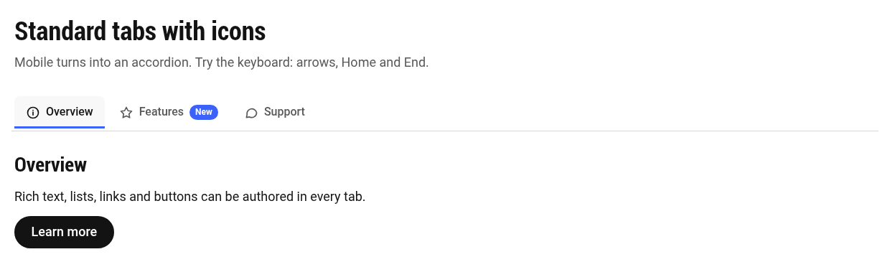

Keyboard focus is clearly visible when visitors use the arrow keys:


### 5.2 Vertical tabs

Tabs on the left and content on the right on desktop. Good for 4–8 tabs or longer titles. The open tab has a **Panel Image**, shown beside the text. The last tab is **Disabled**.

| Tabs block | Tabs |
|---|---|
| Tab Style **Underline** · Orientation **Vertical** · Mobile **Dropdown** | Strategy, Delivery (Panel Image), Operations, Coming soon (**Disabled** on) |


### 5.3 Underline tabs

A light, minimal tab bar with an underline under the selected tab.

| Tabs block | Tabs |
|---|---|
| Tab Style **Underline** · Orientation **Horizontal** · Mobile **Scrollable tabs** | Cloud, AI (Badge "New"), Data & Analytics, Cyber Security |

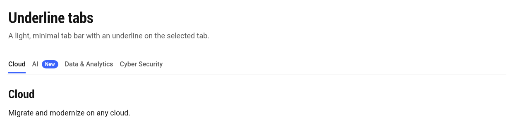

### 5.4 Pill tabs (with auto rotation)

Rounded "segmented control" tabs; the selected tab is filled. This example is centred and rotates every 5 seconds, with a pause/play button.

| Tabs block | Tabs |
|---|---|
| Tab Style **Pill** · Alignment **Center** · Auto Rotation **On** · Auto Rotation Speed **5** | Banking, Insurance, Retail |

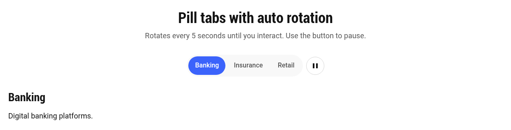

> Rotation stops for good as soon as the visitor clicks or uses the keyboard. It pauses while the pointer or keyboard focus is in the block, never runs for visitors who prefer reduced motion, and is switched off inside Universal Editor.

### 5.5 Card tabs

Each tab is a card with a title and short description. In this example the second tab is the **Default Active** tab and has a badge.

| Tabs block | Tabs |
|---|---|
| Tab Style **Card** · Alignment **Stretch** | Each Tab has a **Tab Description**; Design has **Default Active** on and Badge "Popular" |

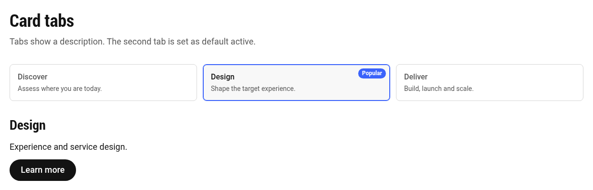

### 5.6 Image tabs

Each tab shows a thumbnail, title and description. Good for visual choices such as products or industries.

| Tabs block | Tabs |
|---|---|
| Tab Style **Image** | Each Tab has a **Tab Image Thumbnail** and **Tab Description** |

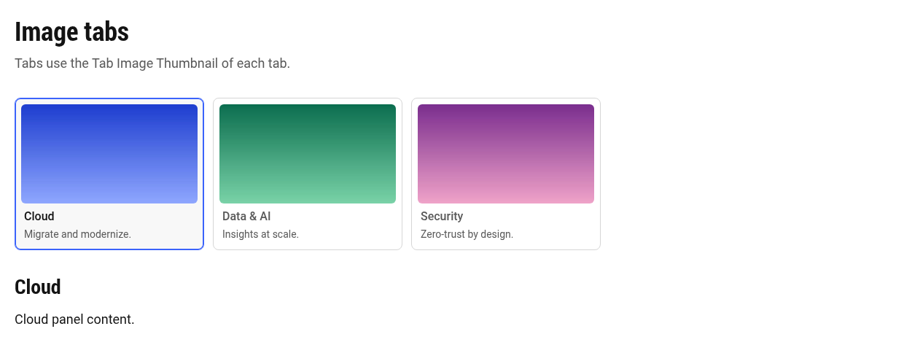

> Thumbnails are decorative (the title already labels the tab), so they don't need alt text. A **Panel Image** inside the content does need alt text.

### 5.7 Mega tabs

Large card-style tabs on a full-width band, with feature-style panels: an image beside a heading, text, list and button. Use this for major landing-page sections. This example uses the **Dark** theme.

| Tabs block | Tabs |
|---|---|
| Tab Style **Mega** · Theme **Dark** · Mobile **Accordion** | Each Tab has a **Tab Description**, **Panel Heading**, **Panel Image** and **Panel Content** |

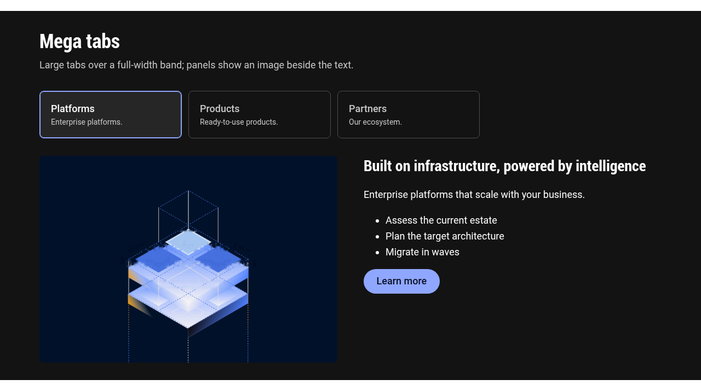

### 5.8 Numbered tabs

Tabs with step numbers, good for processes such as Plan, Build, Run. This example also has **Sticky Tabs** on.

| Tabs block | Tabs |
|---|---|
| Tab Style **Numbered** · Sticky Tabs **On** | Plan, Build, Run |

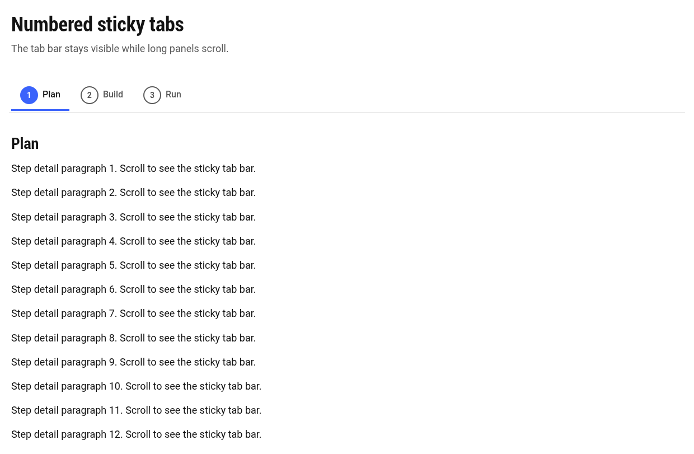

### 5.9 Sticky tabs

Any style can be sticky. While the visitor scrolls through a long panel, the tab bar stays pinned below the site header:

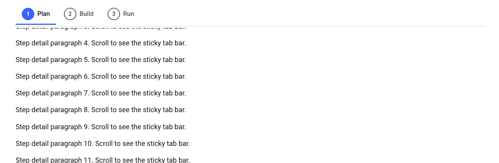

### 5.10 Icon tabs

The icon sits above the label. This example uses the **Brand** theme and is centred.

| Tabs block | Tabs |
|---|---|
| Tab Style **Icon** · Alignment **Center** · Theme **Brand** | About (`info`), Highlights (`star`), Contact (`chat`) |

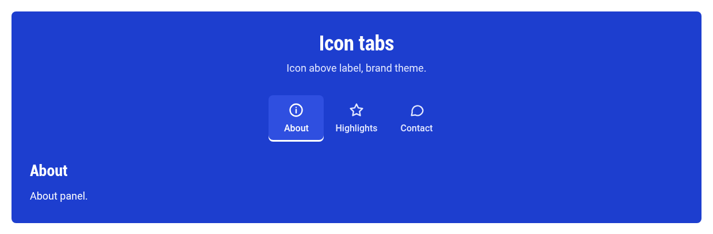

> **Icon** (style) stacks the icon above the label. **Enable Icons** (toggle) adds icons next to the label on any other style, as in 5.1.

### 5.11 Quick picker

| If you need… | Choose |
|---|---|
| A simple tab bar | Standard or Underline |
| A compact switch between 2–4 short options | Pill |
| Tabs that explain each option | Card |
| Visual choices | Image |
| Big landing-page feature sections | Mega |
| Step-by-step content | Numbered |
| Many tabs or long titles | Orientation **Vertical** |
| Long panels | **Sticky Tabs** on |
| A showcase that cycles on its own | **Auto Rotation** on |

---

## 6. Tablet and mobile behaviour

### 6.1 Tablet (600–899px)

Tabs are horizontal on tablet. If they don't fit, the tab bar scrolls sideways and the selected tab is kept in view.


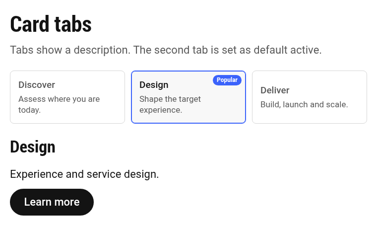

### 6.2 Mobile (below 600px): author's choice

Choose **Mobile Behaviour** on the Tabs block.

**Scrollable tabs**: the tab bar stays and scrolls sideways.

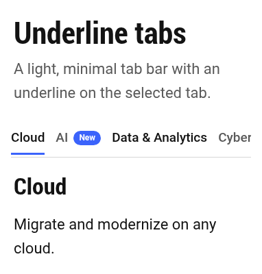

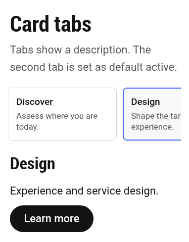

**Accordion**: each tab becomes a collapsible heading. One section is open at a time, and visitors can close them all.


**Dropdown**: a select menu replaces the tab bar. Disabled tabs can't be chosen.


| Mobile Behaviour | Best for |
|---|---|
| Scrollable tabs | 2–5 short titles |
| Accordion | Long content, many tabs, or Mega tabs |
| Dropdown | Many tabs with short panels |

---

## 7. Accessibility: what is built in and what authors need to do

**Built in:**

- Correct tab semantics for screen readers: a tab list, tabs (with selected state) and tab panels, each linked to the other.
- Keyboard: **Tab** moves into the tab bar, **← → ↑ ↓** move between tabs, **Home**/**End** jump to the first or last tab. Disabled tabs are skipped.
- Visible focus outline on every interactive element; tabs are at least 44px tall.
- The accordion and dropdown modes use their own correct semantics on mobile.
- Auto rotation has a pause/play button, pauses on hover and focus, and respects reduced-motion settings.

**Authors should:**

- Always give the Tabs block a **Heading**. It names the tab bar for screen-reader users.
- Write short, unique **Tab Titles**.
- Keep headings in order: if the Tabs heading is H2, use H3 for **Panel Heading**.
- Add **Panel Image Alt Text** when a panel image carries meaning.
- Use **Auto Rotation** sparingly, only for non-essential showcase content.

---

## 8. Tips, limits and troubleshooting

| Situation | What's happening / what to do |
|---|---|
| The Tabs block shows "No tabs yet" | Select the Tabs block → **Add (+)** → **Tab** |
| **Tab** isn't in the Add list | Select the **Tabs block** itself (not the section or another block), then click Add |
| I want Cards, Hero or other blocks inside a tab | Not possible: Edge Delivery doesn't allow blocks inside blocks. Use the Panel Heading, Panel Image and Panel Content fields |
| The wrong tab opens on page load | Check **Default Active** (the first Tab with it on wins). A `#tab-id` in the URL takes priority |
| A deep link doesn't open the tab | Check the Tab's **Tab ID** matches the link, e.g. `#cloud` |
| An icon doesn't show | **Enable Icons** must be on (or use the Icon style), and the icon name must match a file in `/icons` |
| Auto rotation doesn't run in the editor | Expected: it is switched off in Universal Editor and for visitors who prefer reduced motion |

---

## 9. Testing locally

The sandbox page used for the screenshots is `drafts/tabs.plain.html`. It is excluded from the published site. To view it:

```bash
npx aem up --html-folder drafts --port 3001
# then open http://localhost:3001/drafts/tabs
```

Developer details (markup, JavaScript, CSS and extensibility) are in `blocks/tabs/README.md`.
